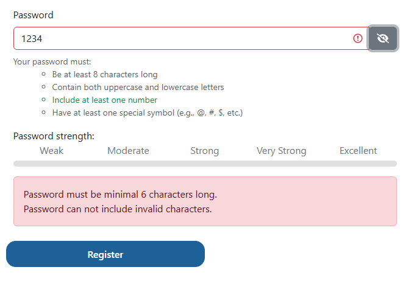
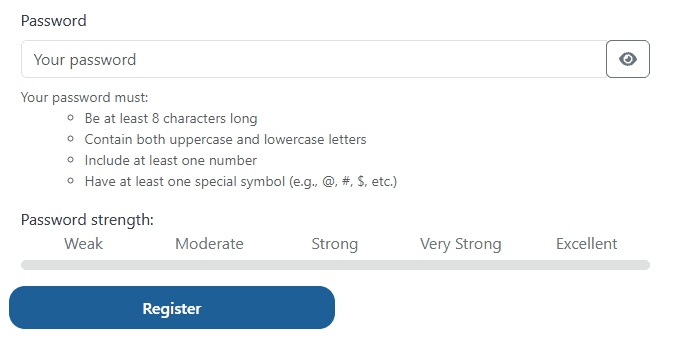
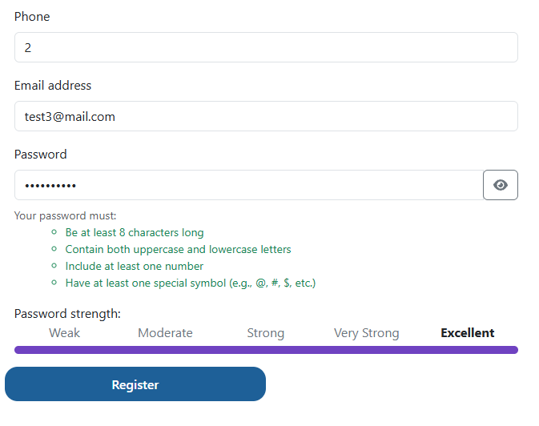
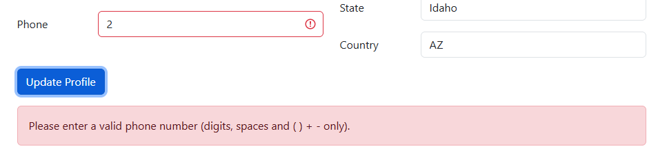
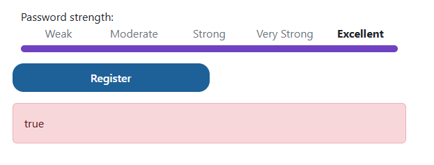
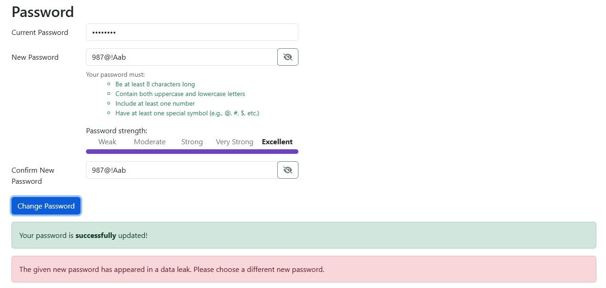
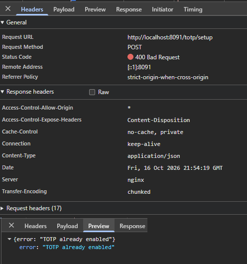
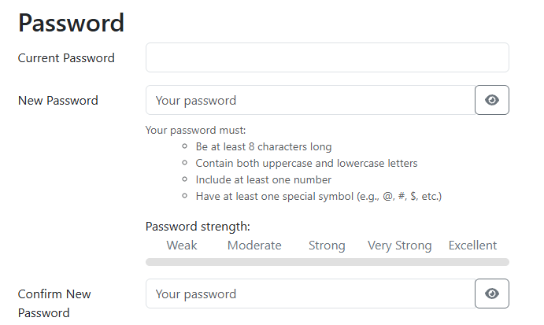

# Exploratory Session 01: Registration, Login and Profile

## Session info

- **Date / duration:** 2026-10-16, ~45 min
- **Charter:** Explore sign-up, sign-in and the profile page to find validation gaps, inconsistent messages and UX problems.
- **Application:** Practice Software Testing (sprint: 5, commit: `ae7caecb`)
- **Environment:** Chrome Version 155.0, Windows 11 + WSL2, UI at `http://localhost:4200`, API at `http://localhost:8091`
- **Test data:** new accounts created during this session (test@mail.com, test2@mail.com); seeded accounts not used. Outgoing email is captured by the local MailCatcher, so nothing leaves the machine.
- **Oracles used:** This session was deliberately done without reading the project documentation, to simulate a first-time user. I judged behavior against (1) what the UI itself states, (2) consistency between screens, and (3) common conventions for forms and authentication. Documentation will be reviewed afterward (in Session 02).

## Summary

| Category | Count |
|---|---|
| Defects | 6 |
| UX issues | 7 |
| Open questions | 4 |

Highest priority: conflicting password rules on sign-up (D-01), inconsistent phone validation between sign-up and profile (D-03), and the 2FA error after a successful enable (D-06).

---

## Defects

### D-01: Conflicting password rules on sign-up
- **Area:** Registration, password field
- **Steps:** Open Sign up, enter `1234` in the password field.
- **Expected:** One consistent rule across the UI hint and the validation message.
- **Actual:** The UI states 8 characters minimum, but the error dialog says "Password must be minimal 6 characters long." The length rules conflict (8 vs. 6). The dialog also says "Password can not include invalid characters.", which is misleading for a numeric input.
- **Evidence:** 
- **Severity:** Medium
- **Issue:** [#1](https://github.com/Moharu/practice-playwright/issues/1)

### D-02: Password strength bar only updates after the Password input regains focus
- **Area:** Registration, password strength indicator
- **Steps:**
  1. Open Sign up and type `1234!@Test` in the Password field. It meets every rule listed in the UI.
  2. Observe the bar, it shows Weak.
  3. Click outside the field, click back into it, then add or delete a character.
- **Expected:** The bar updates after every change to the input, without needing focus changes.
- **Actual:** The bar stays at Weak while typing. It only updates after the field loses focus, regains it, and another keystroke is entered, and then it shows the level that matches the password. Leaving the field alone does not update it.
- **Reproducibility:** 5 of 5 attempts.
- **Notes:** The same functionality exists in the profile page and seems to work as intended.
- **Evidence:** 
- **Severity:** Low
- **Issue:** [#2](https://github.com/Moharu/practice-playwright/issues/2)

### D-03: Phone number validation differs between sign-up and profile
- **Area:** Registration and profile, phone field
- **Steps:** (1) Register with phone `2`. (2) Open the profile page and edit the phone number.
- **Expected:** The same validation rules on both screens.
- **Actual:** Registration accepts `2`. The profile page enforces a minimum of 7 and a maximum of 24 digits.
- **Not verified:** Whether the API itself also accepts the short value, or whether validation exists only in the front end.
- **Evidence:**
  - 
  - 
- **Severity:** Medium
- **Issue:** [#3](https://github.com/Moharu/practice-playwright/issues/3)

### D-04: Error dialog shows "true" when the API is unreachable
- **Area:** Registration, error handling
- **Steps:**
  1. Run `docker compose stop web` so requests to `http://localhost:8091` fail.
  2. Fill in the Sign up form with valid data and submit.
- **Expected:** A meaningful error message such as "Service unavailable, please try again."
- **Actual:** A red dialog with the text "true". The Network tab shows `net::ERR_CONNECTION_REFUSED` for the request to `/register`.
- **Reproducibility:** Reproduced on every attempt.
- **Evidence:**
  - 
  - 
- **Severity:** Medium
- **Issue:** [#4](https://github.com/Moharu/practice-playwright/issues/4)

### D-05: Stale "data leak" error remains next to the success message
- **Area:** Profile, change password
- **Steps:** (1) Try a new password that appears in a data leak such as `1234Test!`, which shows a red dialog. (2) Enter a valid new password and submit.
- **Expected:** The old error is cleared before the success message shows.
- **Actual:** The green "Your password is successfully updated!" dialog appears while the earlier red "data leak" dialog is still visible.
- **Evidence:** 
- **Severity:** Low
- **Issue:** [#5](https://github.com/Moharu/practice-playwright/issues/5)

### D-06: "Failed to load TOTP setup details" shown on every profile visit after 2FA is enabled
- **Area:** Profile, two-factor authentication
- **Steps:**
  1. Enable 2FA on the profile page through the normal flow.
  2. Reload the profile page, or leave and return to it.
- **Expected:** The page shows that 2FA is enabled, with no error.
- **Actual:** The page shows 2FA as enabled and also displays an error dialog: "Failed to load TOTP setup details." This happens on every visit to the page, every time. The Network tab shows `POST /totp/setup` returning `400 Bad Request` with `{"error": "TOTP already enabled"}`. The page appears to call the setup endpoint on load even though 2FA is already active, and shows the rejection as a generic error.
- **Reproducibility:** Always (every visit to the profile page after enabling 2FA)
- **Notes:** See also Q-01 (no option found to disable 2FA).
- **Evidence:** 
- **Severity:** Medium
- **Issue:** [#6](https://github.com/Moharu/practice-playwright/issues/6)

---

## UX issues

### U-01: "Unauthorized" shown for a wrong current password
Changing the password with an incorrect current password shows a red dialog that says only "Unauthorized". A user-friendly message would say the current password is incorrect.

### U-02: Data-leak warning disappears too quickly
The warning about a password found in a data leak vanishes fast enough that it is hard to read. This also matters for accessibility, since users need time to read and react to a message.

### U-03: Silent redirect after a successful password change
After the success message, the page refreshes and returns to the login screen with no explanation. If a forced logout is intended, the user should be told why.

### U-04: Required-field markers are inconsistent
The "Date of Birth" field shows its asterisk on the label, while the other required fields show it inside the input's placeholder text.

### U-05: Date of birth has no input mask
Users have to type the `-` separators manually. A date picker or an input mask would be less error-prone.

### U-06: Phone field gives no guidance on format or country
The phone field rejects `+`, which suggests no country code is expected, yet there is a country dropdown directly above it and no statement about which countries are supported.

### U-07: Current Password field has no show/hide toggle
New Password and Confirm New Password have an eye icon to reveal the typed value, but Current Password does not. The input is masked, so the value is hidden with no way to verify it. That makes a mistyped current password harder to spot, especially since a wrong value only returns the unhelpful "Unauthorized" error (U-01). This may be intentional, so it's worth checking against the documentation.

---

## Open questions

- **Q-01:** Should users be able to disable 2FA after enabling it? I did not find an option. (See also D-06.)
- **Q-02:** Is the product limited to one country? The country dropdown suggests otherwise, and the phone field has no country code. (Related to U-06.)
- **Q-03:** Sign-in front-end validation flags passwords of 2 characters or fewer, while the sign-up UI states 8. This is probably intentional, since login should not enforce the current policy for older accounts. The real inconsistency is within sign-up (D-01).
- **Q-04:** Is the forced logout after a password change intended? (Related to U-03.)

---

## Observations that look correct

- Sign-in with the newly created account worked.
- The message "Invalid email or password" is generic, which is likely intentional to avoid revealing which emails are registered.
- Enabling 2FA worked on the happy path (see D-06 for the error that follows).
- The profile page enforces minimum and maximum phone length (but see D-03).
- The password strength bar on the profile page updates correctly (but see D-02 for the sign-up page).

---

## Ideas for follow-up sessions

- **Password boundaries:** spaces; unicode; which special characters count as "invalid".
- **Email:** invalid formats, duplicate registration, upper vs. lower case, leading and trailing spaces. Does registration or password reset reveal whether an email already exists?
- **Date of birth:** future dates, under 18, very old dates.
- **Name fields:** very long input, quotes, and `<script>`-style strings, checking they render safely.
- **UI vs. API validation:** send invalid data directly to the API (Swagger or `curl`) and compare with the UI.

---

## Next steps

- [x] Create a GitHub Issue for each confirmed defect and link it here (D-01 → #1 through D-06 → #6).
- [ ] Write test cases with IDs (`REG-01`, `AUTH-01`, ...) and mark which ones to automate.